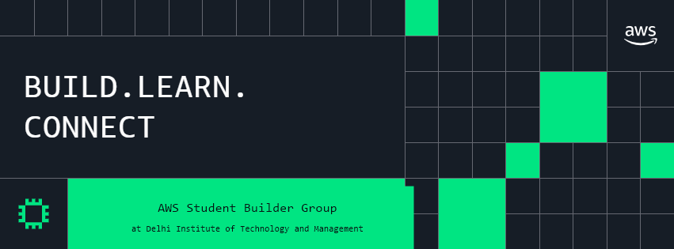
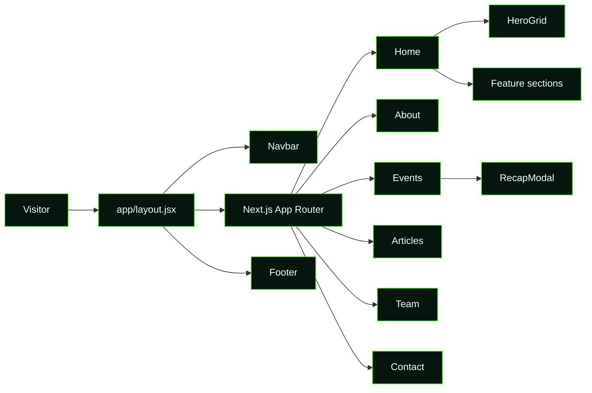

# AWS Student Builder Group — DITM

<div align="center">



### Build. Learn. Connect.

An immersive, dark-mode community website for the AWS Student Builder Group at Delhi Institute of Technology and Management (DITM), Sonipat.

<p>
  <a href="#quick-start">Quick start</a> ·
  <a href="#what-is-inside">Features</a> ·
  <a href="#project-map">Project map</a> ·
  <a href="#deployment">Deployment</a>
</p>


</div>

## About the project

This is the public-facing home for a student-led AWS community. It is designed to make the chapter feel active, approachable, and credible from the first visit—using a restrained neon-green visual system, real event content, responsive layouts, and small interactive details that reward exploration.

The site brings together the chapter’s events, articles, leadership, launch story, contact channels, and community calls to action in one focused experience.

## What is inside

| Area | Experience |
| --- | --- |
| **Home** | Hero introduction, animated snake-grid visual, featured events, leadership preview, articles, milestone recap, and contact console |
| **About** | Chapter story, purpose, and community positioning |
| **Events** | Upcoming and past events with detail cards and recap modal content |
| **Articles** | Curated AWS, cloud, AI, and builder-focused reading |
| **Team** | Leadership and founding-team profiles with responsive cards |
| **Contact** | Direct contact routes and partnership-oriented information |
| **Theme** | Dark/light theme toggle with persisted user preference |

## Visual direction

The interface is intentionally built around a focused visual language:

- deep green-black surfaces with a quiet grid background;
- neon green accents for actions, active states, and community energy;
- Amazon Ember fonts for a familiar AWS-adjacent tone;
- responsive cards, pills, modals, and console-like information panels;
- animation that adds life without becoming the main content.

```text
                 ┌─────────────────────────────┐
                 │        AWS SBGL • DITM       │
                 └──────────────┬──────────────┘
                                │
        ┌───────────────────────┼───────────────────────┐
        │                       │                       │
   Learn & read            Meet the team           Join the community
   Articles + guides       Leaders + founders      Events + contact
        │                       │                       │
        └───────────────────────┴───────────────────────┘
                                │
                    Build practical cloud confidence
```

## Architecture at a glance



## Project map

```text
.
├── app/
│   ├── page.jsx                 # Home page composition
│   ├── about/page.jsx           # Community story
│   ├── articles/page.jsx        # Article library
│   ├── contact/page.jsx         # Contact and partnerships
│   ├── events/page.jsx          # Event directory
│   ├── team/page.jsx            # Team directory
│   └── styles/                  # Design system and page styles
├── components/
│   ├── home/                    # Hero, milestones, and contact console
│   ├── events/                  # Event recap modal
│   ├── Navbar.jsx
│   ├── Footer.jsx
│   └── ThemeProvider.jsx
├── public/
│   ├── assets/                  # Brand assets and SVG marks
│   ├── events/                  # Event photography and posters
│   ├── team/                    # Team profile images
│   └── og-image.png             # Social preview graphic
├── next.config.mjs
├── package.json
└── README.md
```

## Quick start

### Requirements

- Node.js 18.18+ (Node.js 20+ recommended)
- npm

### Run locally

```bash
git clone https://github.com/shbhmexe/Aws-sbg-ditm-site.git
cd Aws-sbg-ditm-site
npm install
npm run dev
```

Open [http://localhost:3000](http://localhost:3000) in your browser.

### Available scripts

| Command | Purpose |
| --- | --- |
| `npm run dev` | Start the local development server |
| `npm run build` | Create and validate the production build |
| `npm run start` | Serve the production build locally |
| `npm run lint` | Run the configured lint command |

## Content updates

Most content is intentionally close to the page that renders it, which keeps chapter updates quick:

1. Edit event and article data in the relevant `app/**/page.jsx` file.
2. Replace media in `public/events`, `public/team`, or `public/assets`.
3. Keep image paths rooted at `/` so they work in both development and production.
4. Run `npm run build` before opening a pull request.

## Deployment

The app is a standard Next.js application and can be deployed to any Node-compatible host. A typical production flow is:

```bash
npm ci
npm run build
npm run start
```

For a managed deployment, connect the repository to Vercel or another Next.js-compatible platform and use the same build command.

## Contributing

Contributions that improve accessibility, mobile behavior, content quality, performance, or community storytelling are welcome.

Before submitting a change:

```bash
npm install
npm run build
```

Please keep the visual system coherent, use descriptive alt text for new images, and avoid adding dependencies for UI details that can be handled by the existing design system.

## Community

AWS Student Builder Group — DITM exists to help students learn cloud fundamentals, build practical projects, connect with peers, and move from curiosity to confidence.

<div align="center">

**Build something useful. Share what you learn. Bring someone with you.**

</div>
